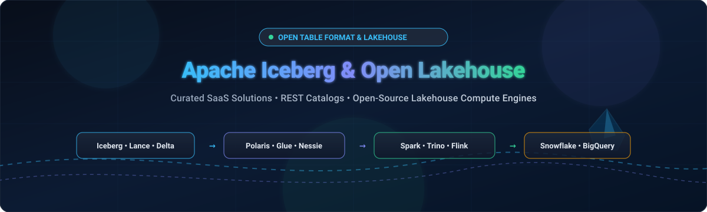

# Awesome Open Table Format & Apache Iceberg Lakehouse 🧊⚡

  

  
  
  
  
  

> A curated list of awesome **Open Table Formats**, **Apache Iceberg Lakehouse infrastructure**, **REST catalogs**, and analytical compute engines for building vendor-neutral, cloud-native data architectures. 🚀

Discover industry-leading **enterprise SaaS platforms** and high-velocity **open-source GitHub projects** powering modern lakehouse storage layers, zero-copy data sharing, Git-for-data versioning, and real-time streaming ingestion. 🌐

---

## 📑 Table of Contents

- [🌐 Sector Overview & Market Dynamics](#-sector-overview--market-dynamics)
- [🏢 SaaS & Hosted Lakehouse Platforms](#-saas--hosted-lakehouse-platforms)
- [💻 Open-Source GitHub Projects](#-open-source-github-projects)
- [🏛️ Key Architectural Capabilities](#️-key-architectural-capabilities)
- [🤝 How to Contribute](#-how-to-contribute)
- [💖 Support](#-support)
- [📈 Star History](#-star-history)
- [⚖️ Disclaimer & License](#️-disclaimer--license)

---

## 🌐 Sector Overview & Market Dynamics

The global **Data Lakehouse & Open Table Format market** is estimated at **$17.1 billion in 2026** (scaling from ~$11.4 billion in 2024 at a CAGR of ~23–25% toward over $74 billion by 2033). The sector exhibits **moderate concentration with high competitive friction**: while cloud hyperscalers (AWS, Google Cloud, Microsoft) and warehouse giants (Snowflake, Databricks) capture significant enterprise spend through integrated engines and managed catalogs, the ecosystem is fundamentally defined by open-source standards (Apache Iceberg, Delta Lake, Apache Polaris) that counteract winner-take-all dynamics by ensuring metadata and multi-engine compute interoperability. 📊

## 🏢 SaaS & Hosted Lakehouse Platforms

| Platform | Company Scale (Valuation / Revenue) | Starting Pricing (Specific Tier) | Free Tier / Trial Limits | Description |
| :--- | :--- | :--- | :--- | :--- |
| **[Google BigLake Iceberg](https://cloud.google.com/biglake)** | Alphabet: **$2.2T+ Market Cap** ($350B+ Ann. Revenue) | **$6.25 / TiB** scanned (on-demand query compute); $0.04 / GiB / mo for metadata storage; $6.00 / 1M Class A operations | **1 TiB / mo** query data processed free; **1 GiB / mo** catalog metadata storage free; 5,000 Class A & 50,000 Class B ops/mo free | Unified lakehouse storage engine across BigQuery and object stores with fine-grained access control and native Iceberg support. |
| **[AWS Glue Iceberg](https://aws.amazon.com/glue/)** | Amazon: **$2.0T+ Market Cap** ($600B+ Ann. Revenue) | **$1.00 / million** catalog requests beyond free allowance; $1.00 / 100,000 metadata objects stored/mo | **1,000,000 requests / mo free forever**; first **1,000,000 metadata objects** stored free forever in Glue Data Catalog | Managed Apache Iceberg REST catalog for AWS analytics engines (Athena, EMR, Redshift Spectrum) with zero infra maintenance. |
| **[Snowflake Apache Iceberg](https://www.snowflake.com/)** | Snowflake: **$55B+ Market Cap** ($3.6B+ Ann. Revenue) | **$2.00 / credit** (Standard Edition virtual warehouse compute, billed per second with 60s minimum) | **30-day free trial** with **$400 in usage credits** (no credit card required upfront; choice of Standard/Enterprise editions) | First-class external Iceberg tables read/write support governed by Snowflake Horizon catalog while avoiding storage lock-in. |
| **[Tabular (Databricks)](https://www.tabular.io/)** | Databricks: **$43B+ Valuation** ($2.6B+ Ann. Revenue; acquired Tabular for ~$1B–$2B) | **$0.07 / DBU** (Serverless Data Engineering compute starting rate; enterprise plans average ~$17,000/yr) | **Databricks Free Edition**: Forever free (1 SQL warehouse, 5 concurrent tasks); **Commercial Trial**: **14-day free trial** with **$400 in credits** | Independent Iceberg REST catalog created by Iceberg co-creators; provides automated compaction, snapshot expiration, and cross-engine RBAC. |
| **[Cloudera Iceberg](https://www.cloudera.com/)** | Cloudera: **$5.3B Acquisition Valuation** (~$1B Ann. Revenue) | **$0.04 / CCU / hour** (Cloudera Compute Unit on CDP Data Hub; $0.07/CCU/hr for Data Warehouse & Engineering) | **60-day free trial** (Cloudera Base on Private Cloud / CDP Private Cloud Data Services with full cluster & SDX governance features) | Enterprise hybrid-cloud data platform with native Apache Iceberg tables and Shared Data Experience (SDX) governance. |
| **[Starburst Galaxy](https://www.starburst.io/)** | Starburst Data: **$3.35B Valuation** ($100M+ ARR) | **$0.50 / compute credit** (Pro tier; a standard 2-worker cluster consumes ~12 credits/hr = ~$6.00/hr) | **30-day free trial** with **$500 in free compute credits**; automatically transitions after 30 days to a **forever-free tier (up to 3 clusters)** | Fully managed Trino query engine connecting directly to Iceberg tables and open catalogs across clouds with zero data migration. |
| **[Dremio Arctic](https://www.dremio.com/)** | Dremio: **$2.0B Valuation** (~$75M ARR) | **$0.20 / DCU** (Dremio Compute Unit on Dremio Cloud, billed per second; XS engine starts at ~$6.40/hr) | **Forever-free Standard tier**: Capped at **10 users**, **200 tables**, **1,000 views**, and Small engine size (no credit card required) | Autonomous lakehouse management engine & catalog built on Apache Polaris providing branch-and-merge Git-for-data capabilities. |
| **[Upsolver](https://www.upsolver.com/)** | Upsolver: **~$150M Valuation** ($40M+ Funding Raised) | **$0.10 / GB** processed ingestion tier (SQLake volume-based plan; data transformations free) | **14-day free trial** (unlimited streaming pipelines; includes optional $300 partner compute credits via cloud marketplaces) | Real-time streaming ingestion pipeline and automated compaction/clustering engine tailored specifically for Apache Iceberg tables. |
| **[Onehouse](https://www.onehouse.ai/)** | Onehouse: **~$120M Valuation** ($35M Funding Raised) | **$0.035 / GiB** read/written (via Quanton unbundled Spark engine; managed OCU tiers for full clusters) | **Forever-free tier**: First **100 GiB / month** processed free forever on Quanton engine (BYOC deployment) | Universal lakehouse data service with automated ingestion and multi-table synchronization across Iceberg, Hudi, and Delta formats. |
| **[CelerData](https://celerdata.com/)** | CelerData: **~$100M Valuation** ($60M+ Funding Raised) | Enterprise BYOC/Cloud custom compute quotes; underlying open-source StarRocks engine is $0 software license | **30-day free trial** (unrestricted cluster deployment & node scaling); plus **Free Developer Tier forever** (1 Frontend + 1 Backend node) | Real-time MPP query acceleration engine built on StarRocks delivering sub-second BI query latency directly on Apache Iceberg data. |

## 💻 Open-Source GitHub Projects

Explore the top open-source projects across the Apache Iceberg, open table format, and lakehouse ecosystem. Sorted in descending order by GitHub Stars_Count: ⭐

- **[Apache Spark](https://github.com/apache/spark)**   
  ⚡ Unified engine for large-scale distributed data processing; the primary compute engine for Apache Iceberg batch and streaming pipelines via the `iceberg-spark-runtime` connector.

- **[DuckDB](https://github.com/duckdb/duckdb)**   
  🦆 High-performance embeddable analytical SQL database engine; provides ultra-fast client-side querying directly over Apache Iceberg metadata and Parquet data files.

- **[Apache Flink](https://github.com/apache/flink)**   
  🌊 Open-source stream processing framework with stateful computations; powers real-time streaming ingestion, CDC capture, and streaming writes into Apache Iceberg tables.

- **[Trino](https://github.com/trinodb/trino)**   
  🗡️ Fast distributed SQL query engine for interactive ad-hoc analytics; features deep native Apache Iceberg connector support with REST catalog integration and query pushdown.

- **[StarRocks](https://github.com/StarRocks/starrocks)**   
  🌟 Next-generation sub-second MPP OLAP database engine engineered for high-concurrency real-time analytics directly over Apache Iceberg and open lakehouse tables.

- **[Apache Iceberg](https://github.com/apache/iceberg)**   
  🧊 The industry-standard open table format for huge analytic tables; brings SQL-table reliability to data lakes with ACID transactions, schema evolution, hidden partitioning, and time travel.

- **[Delta Lake](https://github.com/delta-io/delta)**   
  🔺 Open-source storage framework enabling building lakehouse architectures with compute engines including Spark, PrestoDB, Flink, and Trino, featuring UniForm cross-format reading for Iceberg.

- **[Lance](https://github.com/lance-format/lance)**   
  🏹 Modern columnar data format optimized for multimodal AI, vector search, and random-access analytics; integrates with Iceberg catalogs and tabular engines.

- **[Apache Hudi](https://github.com/apache/hudi)**   
  🪶 Transactional data lakehouse platform bringing stream processing primitives to batch table storage with record-level updates, deletes, and change streams.

- **[lakeFS](https://github.com/treeverse/lakeFS)**   
  🌳 Scalable Git-like data version control system over object storage; enables branching, committing, rolling back, and merging production data lakes across Iceberg and Delta formats.

- **[Apache Paimon](https://github.com/apache/paimon)**   
  🔄 Streaming data lake platform enabling real-time lakehouse architectures with high-throughput streaming updates and sub-second point queries.

- **[Apache Gravitino](https://github.com/apache/gravitino)**   
  🪐 High-performance, geo-distributed, federated metadata lake with native Iceberg REST catalog services, access control, auditing, and multi-cloud catalog federation.

- **[Apache Polaris](https://github.com/apache/polaris)**   
  🧭 Vendor-neutral open-source implementation of the Apache Iceberg REST Catalog spec; graduated Apache TLP enabling multi-engine interoperability without catalog lock-in.

- **[pg_lake](https://github.com/Snowflake-Labs/pg_lake)**   
  🐘 PostgreSQL extension for native Apache Iceberg table querying and data lake access directly within Postgres databases.

- **[OLake](https://github.com/datazip-inc/olake)**   
  🏎️ Ultra-fast replication engine streaming CDC from PostgreSQL, MySQL, MongoDB, Kafka, and S3 directly into optimized Apache Iceberg tables.

- **[Project Nessie](https://github.com/projectnessie/nessie)**   
  🦕 Transactional Iceberg catalog bringing Git-like branch-and-merge version control semantics to data lakehouses.

- **[Lakekeeper](https://github.com/lakekeeper/lakekeeper)**   
  🦀 High-performance Apache Iceberg REST Catalog written in Rust, featuring fine-grained access control, credential vending, and comprehensive audit logs.

- **[Iceberg Rust](https://github.com/apache/iceberg-rust)**   
  ⚙️ Official Apache Iceberg implementation in native Rust for high-throughput, low-latency lakehouse systems and custom analytical runtimes.

- **[Apache Amoro](https://github.com/apache/amoro)**   
  🛠️ Lakehouse management system built on Apache Iceberg and mixed streaming/batch table formats, automating background table maintenance, compaction, and optimizations.

- **[PyIceberg](https://github.com/apache/iceberg-python)**   
  🐍 Official Python implementation of Apache Iceberg; provides native Pythonic reading, schema inspection, and metadata interactions without requiring a JVM.

- **[Iceberg Go](https://github.com/apache/iceberg-go)**   
  🔷 Official Apache Iceberg library written in Go for cloud-native microservices, telemetry ingestion, and REST catalog tools.

- **[DuckDB Iceberg Extension](https://github.com/duckdb/duckdb-iceberg)**   
  🔍 Official DuckDB extension enabling direct SQL queries against Apache Iceberg tables with snapshot navigation and schema evolution support.

## 🏛️ Key Architectural Capabilities

When designing an open lakehouse architecture based on Apache Iceberg and open table formats, consider the following primary architectural layers: 🏗️

1. **Table Format & Data Storage Layer**:
   - **ACID Transactions**: Serializable isolation and snapshot isolation for concurrent readers and writers without read locking.
   - **Schema & Partition Evolution**: In-place column addition/renaming and hidden partitioning without costly table rewrites.
   - **Time Travel & Rollback**: Reproducible queries against historical snapshots, enabling zero-copy debugging and audit trails.

2. **Catalog & Metadata Federation**:
   - **Iceberg REST Catalog Specification**: Standardized HTTP REST specification implemented by open-source systems (Apache Polaris, Lakekeeper, Gravitino) and managed cloud services (Snowflake Horizon, AWS Glue, Google BigLake).
   - **Cross-Engine Interoperability**: Decoupling the storage format and catalog allows Apache Spark, Trino, Apache Flink, DuckDB, and StarRocks to access identical datasets simultaneously.

3. **Data Management & Optimization**:
   - **Automated Compaction & Clustering**: Asynchronous compaction of small Parquet/ORC data files to maintain low query latency and optimal file sizes.
   - **Snapshot Expiration & Orphan File Cleanup**: Maintaining healthy metadata footers and controlling object storage costs.

## 🤝 How to Contribute

Contributions are warmly welcome! 🙌

1. Fork the repository. 🍴
2. Add or edit entries in `README.md` following the existing structured format. ✍️
3. Include: name, official link, 1–2 sentence description, and relevant SaaS pricing or open-source repo details. 📋
4. Submit a Pull Request with a clear explanation of your additions. 🚀

Star the repository if you find it helpful! ⭐

## 💖 Support

Thank you for exploring and using this curated Lakehouse ecosystem guide! If you find this resource valuable, please consider supporting the project:

- ⭐ **Star this repository** on GitHub to help others discover it.
- 🍴 **Fork and contribute** new open-source projects, tools, or updates.
- 📢 **Share this list** with fellow data platform engineers, lakehouse architects, and analytics practitioners.
- ☕ **Buy a coffee & sponsor**: Support ongoing research and maintenance via the [GitHub Sponsor Dashboard](https://github.com/sponsors/ishaddutta2007).

## 📈 Star History

## ⚖️ Disclaimer & License

- This is a **community-curated** list — not exhaustive and not an endorsement. 📝
- Open table format and lakehouse platforms handling production data must comply with organizational security policies and data governance requirements; **Iceberg's table encryption provides fine-grained KMS-backed security**—verify configuration before storing sensitive data. 🔐
- **Open-source Iceberg lakehouse is mature at the format and catalog layers but requires operational investment**—Apache Iceberg provides the table format, Polaris provides the REST catalog, and Gravitino provides federated metadata. However, **managed platforms differentiate on operational simplicity**—AWS Glue, Google BigLake, and Snowflake handle catalog management, security, and scaling. Choose based on whether your team has the engineering capacity to operate open-source infrastructure or needs managed convenience. 💡
- Verify license terms for commercial use; Apache Iceberg, Polaris, and Gravitino all use Apache 2.0. 📜

---

**Made with ❤️ for data platform engineers, lakehouse architects, and organizations building vendor-neutral data infrastructure.** 🚀
